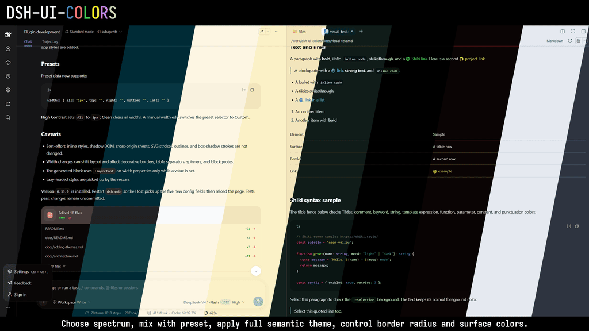

# dsh-ui-colors

> <div align="center"><b style="font-size: 1.15em;">Customize maximum theme coverage with a minimal set of controls.</b></div>


---
This is a UI plugin I wrote for myself for controlling how DSH WEB client looks like. Basically I wanted to achieve maximum theme coverage with a small set of controls. I mainly use DSH from VS Code, where I already have a custom editor theme, so I wanted to match built-in browser `dsh web` window with my IDE's theme.

Directly applying VS Code theme into DSH is not possible without some crude adapters, so instead I started with [dsh-web-ui-design-spec.md](https://github.com/DDDPG/dsh-plugins/blob/main/docs/dsh-web-ui-design-spec.md) and built this plugin. It modifies basic primitives and color tokens, so UI should be consistent in other plugins that utilize the same default DSH CSS. Yes, of course you can modify the UI, using the agent itself, but here's the plugin already that covers most of basic UI needs for majority of geeks out there.


https://github.com/user-attachments/assets/38989c9b-eb91-4b53-b662-8c608da9e6c2


---

## What this UI plugin offers and adds in DSH?
Under **Settings → Customize**:

- **Palette** — nine spectra, color presets, and the **Full semantic theme** switch.
- **Syntax highlighter** — six Shiki token themes: Default, GitHub, Nord, Dracula, Solarized, Monokai.
- **Selection** — **Apply spectrum to ::selection**, independent of the full theme.
- **Colors / Neutral / Borders** — per-surface fills, 16 neutral steps, and four border colors.
- **Border radius** — Default, Half, or None.
- **Language** — English and Simplified Chinese follow the DSH locale setting; changing the DSH language updates the section without a reload.

The `dsh-ui-colors` plugin adds a "Customize" section under "Settings", where you can have some options to tweak: under Palette you have a "Spectrum" to choose from main accent colors, and under "Preset" there are some basic presets that change the values of surface fills, neutral color steps and border colors.

You also have a "Full semantic theme" switch, where the colors from the spectrum are also applied with its own inner color scope, adding some more colors instead of just hue and saturation from one main color.

For those who are paying meticulous attention to details, the `::selection` of the text can also be overriden by checking independent option "Apply spectrum to ::selection". Also "Border radius" can be changed from default to half and to none (having square, sharp corners if someone prefers).

DSH uses the [Shiki](https://shiki.style/) syntax highlighter, so that colors can be changed too. There are already a few themes added.

If customization is needed, you can always add your "Spectrum" colors or "Presets". The data lives in `lib/client.js` and adding a spectrum or preset is a small source change. The agent can help with that.

Oh, and of course you can manually modify some values per surface in "Colors", also changing some "Neutral" values here and there and to play around with "Borders".

---

Plugin uses the supported theme seam rather than patching the UI:

```js
ctx.theme.overrideTokens('ui-colors', {
  '--dsw-specific-sidebar-fill': { light: '#…', dark: '#…' },
  …
})
```

Colors and borders are ordinary volatile plugin config, so they persist in the profile patch alongside the other UI preferences. The override layer applies live; no reload is needed after changing a value.

---

> [!TIP]
> That is all for now, but I am open to suggestions for what to add next. Or you can rely on your agent and inject some presets and spectra yourself.


## Documentation

- [Architecture](docs/architecture.md) — Host/client split, token layers, state, and scoped surfaces.
- [Token policy](docs/token-policy.md) — coverage categories, audits, and how to classify a new token.
- [Adding themes](docs/adding-themes.md) — spectra, color presets, and Shiki syntax presets.
- [Install and troubleshoot](docs/install.md) — npm/bundle install, restart rules, and common failures.
- [Visual color test](docs/visual-test.md) — paste-ready Markdown for checking surfaces, links, tildes, selection, and Shiki.
- [Changelog](CHANGELOG.md) — release history and current alpha scope.
- [Security policy](SECURITY.md) — supported versions and private vulnerability reporting.
- [Accessibility audit](docs/accessibility.md) — source-level review, keyboard/ARIA fixes, and remaining gaps.

## Technical breakdown for agents

Below are the specific details that can be of use for working agents.

## Surfaces

| Surface | What changes | How |
| --- | --- | --- |
| **Sidebar** | Left column and title row | `--dsw-specific-sidebar-fill` |
| | Nav hover / active rows | `--dsw-specific-sidebar-nav-item-hover`, `--dsw-specific-sidebar-nav-item-active` |
| | Sidebar text, buttons, borders, scrollbar | Scoped `--dsw-alias-label-*`, `--dsw-alias-button-*`, `--dsw-alias-interactive-bg-*`, `--dsw-alias-border-l3`, `--dsw-alias-scrollbar-*` |
| **Main** | Center column / transcript background | Scoped `background` + `--dsw-alias-bg-base` on the center column |
| **Raised Surface** | Primary raised surfaces: cards, pane chrome, the Trajectory toolbar | Global `--dsw-alias-bg-layer-1` |
| **Secondary Main** | Secondary raised surfaces: settings panel/cards, raised cards, popovers | Global `--dsw-alias-bg-layer-2` |
| **Composer** | Message input surface | `--dsw-specific-input-major` |
| **Right panel** | Files/terminal/browser column | Scoped `background`, `--dsw-alias-bg-base`, `--dsw-alias-bg-layer-1/2/3` on the right column |
| **User bubble** | User message bubble | `--dsw-specific-bubble`, plus a derived `--dsw-specific-bubble-highlight` |
| **Code blocks** | Markdown code block and header | `--dsw-alias-markdown-code-block`, plus a derived `--dsw-alias-markdown-code-block-banner` |

An empty mode keeps its theme default, so you can override only light or only dark. Values use `#RRGGBBAA`; a six-digit value is accepted and treated as opaque (`ff`). The sidebar’s derived text colors use the fill’s RGB channels only, so a translucent sidebar is composited by the browser while its text contrast is still calculated from the opaque color.

## Neutral

The **Neutral** row exposes the 16 pure `--dsw-static-neutral-*` steps (`00` through `1000`), each with independent light/dark `#RRGGBBAA` inputs. An empty step keeps the active theme value; placeholders show the host neutral scale. Explicit neutral values override both the host scale and the palette-tinted neutral ramp generated by the full theme, because the color layer is applied last. The row has its own **Reset**; the Colors and Borders resets do not clear it. Its input grid starts collapsed under a **Show neutral inputs** disclosure; the header and Reset stay visible.

## Borders

The **Borders** row exposes the four shared border aliases. Each level has independent light/dark values and the same `#RRGGBBAA` format. Its grid starts collapsed under a **Show border inputs** disclosure.

| Level | Token | Light placeholder | Dark placeholder |
| --- | --- | --- | --- |
| **Border 1** | `--dsw-alias-border-l1` | `#0000000a` | `#ffffff0f` |
| **Border 2** | `--dsw-alias-border-l2` | `#0000001a` | `#ffffff1f` |
| **Border 3** | `--dsw-alias-border-l3` | `#0000001f` | `#ffffff29` |
| **Border 4** | `--dsw-alias-border-l4` | `#00000029` | `#ffffff33` |

An empty level keeps the theme default. **Border 4** is the strongest level; it also feeds some divider fills and strong elevation strokes, so changing it can affect more than outlines. Border widths and styles remain component-owned. The row has its own **Reset**; the Colors reset clears only surface fills.

The focus ring (`--dsw-focus-ring-color`) is not one of these four levels and stays theme-controlled.

**Secondary Main** maps to the global `--dsw-alias-bg-layer-2` alias, not a Settings-specific override. It therefore also changes every secondary surface that consumes that token — the Settings dialog and its cards are the most visible examples, but raised cards and popovers use the same layer. Choose a fill that keeps text readable across those surfaces.

**Raised Surface** maps to the global `--dsw-alias-bg-layer-1` alias. It changes every primary raised surface that consumes that token, including cards, pane chrome, and the Trajectory toolbar; it is not scoped to a single container.

## Border radius

The **Border radius** row exposes the shared `--dsw-radius-*` scale as three mutually exclusive presets:

| Preset | Result |
| --- | --- |
| **Default** | `4 / 8 / 12 / 16 / 20 / 28px` for `xs / sm / md / lg / xl / panel` |
| **Half** | Each default divided by two and floored: `2 / 4 / 6 / 8 / 10 / 14px` |
| **None** | Every radius token set to `0px` |

The row uses a separate override layer (`ui-colors-radius`) from the surface colors (`ui-colors`), so changing one does not replace the other. The selected preset is persisted as `radiusMode` in the same `ui-colors` settings namespace and applies live.

Only token-based radii change. Components that draw circles or pills with a hardcoded `50%`/`999px` radius keep their circular shape; the preset controls the shared radius scale.

The **Automation tasks** page and its right-side task tab are an exception in the other direction: that package hardcodes most of its radii (`16px`, `14px`, `12px`, `10px`, `18px`, and so on) instead of consuming the shared scale. The plugin bridges those known local class names back to the radius tokens, so the same Default/Half/None preset applies there too. The bridge is best-effort; if those class names change, the schedule package keeps its original values.

## Palette

The top row exposes a `Bluish` / `Olive` / `Ember` / `Midnight Plum` / `Deep Charcoal` / `Solarized` / `Cyan OLED` / `Neon Yellow` / `Acid Hacker Green` picker plus a **Full semantic theme** switch. The picker shows a colored `▓` preview beside the current spectrum name, and repeats it beside every choice in the open list. `Bluish` is the default and adds no override. The spectrum presets remap the raw static scales:

- `--dsw-static-neutral-bluish-*` — the blue-tinted neutral scale used for backgrounds, text, borders, and many raised surfaces.
- `--dsw-static-blue-*` — the selection/informational blue scale.
- `--dsw-static-deepseek-*` — the brand accent scale used by links, focus, business state, info buttons, and the user bubble.

`Olive`, `Ember`, `Midnight Plum`, and `Deep Charcoal` apply fixed palettes generated from the shipped bluish values by rotating hue in OKLCH while preserving lightness. Plum keeps a refined plum accent; Charcoal uses cool near-neutrals with muted steel-blue accents. `Solarized` uses the actual Solarized base and accent colors: the neutral scale becomes base3/base2/base1/base0/base00/base01/base02/base03, the blue scale becomes Solarized cyan, and the deepseek scale becomes Solarized blue.

`Cyan OLED` uses a cool cyan-tinted neutral scale with near-black `900`–`1000` steps, a cyan blue scale, and a bright cyan deepseek accent. Its dark end is deliberately close to black for OLED-style surfaces. Like Acid Hacker Green, it always runs as a full semantic theme and locks the switch on; its stronger cyan seed gives labels, surfaces, links, buttons, focus, and selection more cyan presence.

`Neon Yellow` uses a warm yellow-tinted neutral scale, a neon yellow accent in Dark, and a deeper amber accent in Light for contrast. It also always runs as a full semantic theme and locks the switch on. Dark appearance gets near-black surfaces with bright yellow labels, links, focus, and borders; Light appearance gets warm pale surfaces with deep amber accents.

`Acid Hacker Green` is the hand-tuned dark variant: in Dark appearance it keeps pitch-black surfaces and phosphor-green text, and its dark semantic border tokens are black. In Light appearance the full theme generates a green-tinted light counterpart from the same accent. It no longer forces `color-scheme`. For the plain spectrum presets, semantic green/red/amber status colors and the pure neutral scale stay unchanged, so success/error/warning remain recognizable.

The presets are fixed snapshots of the current DSH base scale. If a future DSH build changes that scale, the presets keep the values they were generated from. Some aliases use raw hex or `color-mix()` and therefore do not follow the palette.

The **Full semantic theme** switch turns the selected spectrum into a complete theme with separate light and dark variants. Light appearance uses near-white palette-tinted surfaces, dark tinted text, a darker accent (`deepseek-600`), and darker status colors. Dark appearance uses near-black surfaces, light tinted text, the brighter accent (`deepseek-400`), and the bright status colors. The theme follows the host Light/Dark appearance, so no `color-scheme` is forced; code syntax token colors follow the host mode unless a **Syntax highlighter** preset overrides them. The pure `--dsw-static-neutral-*` ramp is palette-tinted too, so raw neutral consumers match the selected spectrum; `neutral-bluish` remains the stronger tint. It does not force component borders; hover and focus borders follow the token values. **Acid Hacker Green** remains the preset shortcut: dark keeps the hand-tuned black/green theme, light gets a generated green light theme, and the switch is checked and disabled there. **Cyan OLED** and **Neon Yellow** are likewise locked on, but use the generated cyan and yellow themes in both appearances. Explicit surface colors from **Colors** and explicit border colors from **Borders** still win over the theme's aliases because the color layer is applied last.

**Apply spectrum to ::selection** is independent of the full-theme switch. When enabled, selected text uses the current spectrum's accent at 40% alpha in both Light and Dark; when disabled, the host selection color returns. The check lives beside **Full semantic theme** in Palette.


The sidebar also derives a readable text palette, hover/active tints, button fills, borders, and scrollbar colors from its fill, so a dark sidebar in light mode stays legible. The other surfaces keep the active theme's text colors; choose fills that keep enough contrast with the current light/dark text.

## Syntax highlighter

The **Syntax highlighter** row overrides the nine Shiki `--shiki-token-*` CSS variables used by fenced code blocks. It offers **Default**, **GitHub**, **Nord**, **Dracula**, **Solarized**, and **Monokai**. Each option supplies separate Light and Dark token colors; **Default** removes the override and restores the host Shiki tokens.

The row uses a separate `ui-colors-shiki` layer. It does not change `--shiki-background` or `--shiki-foreground`; those stay tied to the **Code blocks** surface and the active theme, so the code block fill you choose in Colors remains in control. The picker shows four `▓` previews sampled from the preset's comment, keyword, string, and function colors.

## Presets

The **Preset** picker beside **Spectrum** applies a named set of Colors, Neutral, and Borders values, or clears every color override with **Clean**. Every option shows two `▒` previews sampled from its Neutral `500` value: the first for Light, the second for Dark. A named preset only writes the fields it defines; light values and unlisted fields keep their current state. Any manual edit in Colors, Neutral, or Borders switches the dropdown to **Custom**. Presets do not change the palette, Full semantic theme, or Border radius.

| Preset | Surfaces | Borders |
| --- | --- | --- |
| **Pitch Black** | Dark: every surface `#000000ff` | Dark: Border 1 `#ffffff05`, Border 2 `#ffffff15`, Border 3 `#ffffff07`, Border 4 `#ffffff12` |
| **Copper Patina** | Light: warm parchment; Dark: deep oxidized patina | Light: muted copper alpha; Dark: brighter copper alpha |
| **Gruvbox** | Light: classic cream and sand; Dark: warm charcoal and earth | Light: warm gray alpha; Dark: pale sand alpha |
| **High Contrast** | Light: white and near-white surfaces; Dark: black and near-black surfaces | Light: strong black alpha; Dark: strong white alpha |
| **Yellow Blood** | Light: yellow and bone surfaces; Dark: near-black red surfaces, blood-red bubble | Light: deep red alpha; Dark: yellow-to-red borders |
| **Nord** | Light: Snow Storm surfaces; Dark: Polar Night surfaces | Light: Nord blue alpha; Dark: frost-to-snow alpha |
| **Clean** | Clears every surface color | Clears every border color and every neutral step |

Pitch Black also writes Neutral `00` through `900` to a dark mapping; Neutral `1000` is left untouched. **Copper Patina** is a complete two-mode scheme: warm parchment and copper in Light, deep patina and brighter copper in Dark, with a matching warm neutral ramp in both modes. **Gruvbox** follows the classic warm palette: cream and sand surfaces in Light, charcoal and earth surfaces in Dark, with full warm neutral ramps in both modes. **High Contrast** uses white/near-white surfaces and a strong black border in Light, black/near-black surfaces and a strong white border in Dark, and a full grayscale neutral ramp in both modes. It does not change text aliases; the extreme surfaces and stronger borders make the host text color easier to read. **Yellow Blood** is a cyberpunk yellow-and-red scheme: yellow and bone surfaces with deep red borders in Light, near-black red surfaces with yellow-to-red borders and a blood-red user bubble in Dark, plus a warm amber neutral ramp in both modes. **Nord** follows the Nord palette: Snow Storm surfaces and Nord-blue borders in Light, Polar Night surfaces and frost-to-snow borders in Dark, with a frost-tinted neutral ramp. Choose **Nord** in both the Preset picker and the Syntax highlighter row for a complete Nord look. **Clean** clears Colors, Neutral, and Borders and leaves the dropdown on Clean until the next manual edit.

The preset list is hard-coded; adding another preset means adding one entry to `PRESETS` in `lib/client.js`.

## Development

Run `npm install` once, then `npm test`. The manifest test compares the Host `Config` with `lib/manifest.js`; the smoke test compares the browser data with the same manifest.

## Token coverage

Every custom property in the installed DSH theme is assigned one policy in `test/token-policy.mjs`:

- **owned** — the full-theme layer must override it.
- **derived** — no direct override; it resolves through owned tokens.
- **syntax** — controlled by the Syntax highlighter presets; host-owned on Default.
- **host** — intentionally left to DSH, such as status scales and depth shadows.
- **ignored** — not a color token, such as typography and geometry.

The current inventory is 425 tokens: 178 owned, 6 derived, 9 syntax, 31 host, and 201 ignored. Status scales and thinking gradients are currently host-owned; move them to `owned` when their overrides land.

`npm test` checks the installed theme when it can find it and falls back to the checked-in token fixture otherwise. When DSH adds or removes a token, the test fails until the token has a policy. Run the audit directly with:

```bash
npm run audit:tokens
```

If the output is correct after a DSH update, refresh the fallback fixture with:

```bash
npm run audit:tokens:update
```

## Install

Install the alpha from npm:

```bash
dsh plugin --profile web add dsh-ui-colors@alpha
```

Then open the **Plugins** page in DSH Web, enable **dsh-ui-colors**, and restart `dsh web` if the Host does not recompose automatically.

The package declares `dsh.bundle`, so the Plugins page can install and enable it as a bundle. It applies its own `cordis.patch.yml`; do not also add a manual `ui-colors` insert entry.

For local development from a checkout:

```bash
dsh plugin --profile web add /path/to/dsh-ui-colors
```

Then enable the bundle in **Plugins** and restart `dsh web`. Moving the checkout requires adding the new path again.

Open **Settings → Customize** and use the **Palette**, **Colors**, **Neutral**, **Borders**, and **Border radius** rows. In **Palette**, choose a spectrum, optionally pick a **Preset** to overwrite the dark Colors and Borders values, and optionally tick **Full semantic theme**. In **Colors**, **Neutral**, and **Borders**, type a `#RRGGBBAA` value (or a six-digit `#RRGGBB`, treated as opaque) into any cell and press Enter or leave the field to apply it. Invalid or partial values revert. The **×** beside a field clears just that stored value (both the live override and the saved field). **Reset** in **Colors** clears every surface override; **Reset** in **Neutral** clears every neutral override; **Reset** in **Borders** clears every border override. In **Border radius**, click a preset; **Default** is the explicit four-to-twenty-eight-pixel scale, not “no override”.

## Uninstall

1. Disable or remove **dsh-ui-colors** in the DSH Web **Plugins** page.
2. Run `dsh plugin --profile web remove dsh-ui-colors` to remove the dependency.
3. Restart `dsh web`.

The color and radius override layers, scoped stylesheet rules, and body markers are disposed with the plugin.

## License

**MIT**. See [LICENSE](LICENSE).

## Adding another surface

Add an entry to `SECTIONS` in `lib/manifest.js`. The Host `Config` picks it up automatically. Until client generation lands, mirror it in `SURFACES` in `lib/client.js`, and add the token assignment in `applyColors`. If the surface needs a scoped container, add a marker attribute and matching guarded rule to `STYLE_TEXT`.

## Caveats

- **Main**, **Right panel**, and **Sidebar** attach their scoped rules through CSS-module suffixes (`*_centerCol`, `*_rightbarCol`, `*_sidebarCol`). If a future DSH build renames one, that surface's background token or override still applies, but its scoped container styling falls back to the theme.
- Only the sidebar auto-adjusts text. Main, composer, panel, bubble, and code fills keep the theme's text colors, so very dark fills in light mode (or the reverse) can reduce readability.
- Menus use a translucent material (`--dsw-specific-menu`); overriding it with an opaque color is intentionally not exposed.
- The radius preset uses the six values from `base.css` in the installed build. If a future DSH build changes the base radius scale, update `RADIUS_DEFAULTS` in `lib/client.js`.
- Overlays that escape a surface (for example, a popover anchored to the Settings button) keep the normal theme surface.
- The settings shell has no public per-section icon option, so the pipette is a CSS mask applied to the `Customize` nav button after it renders. If the section label is changed, update `SECTION_LABEL` and the nav-tagging logic; otherwise the shell falls back to its default settings icon.
